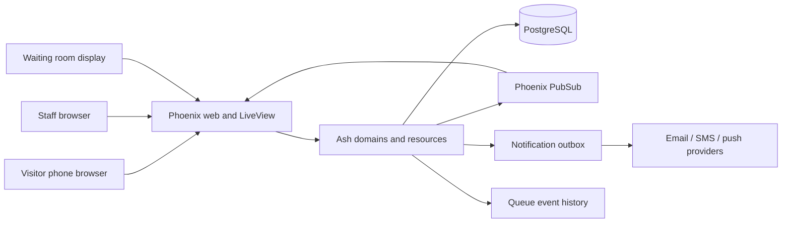

# Kewkew high-level architecture

## UX concept

An interactive, responsive mock for the first visitor and staff workflows is available at [`ux-mock.html`](ux-mock.html). Open the file directly in a browser. It includes a staff live queue view, visitor service selection and ticket tracking, and queue settings with a visitor-form preview. The sample services demonstrate the two initial identity policies: required first/last name and anonymous numbered ticket. This is a discussion prototype, not a connected application screen.

## Purpose

Kewkew lets a business operate one or more virtual queues. A visitor joins a queue from a phone browser, follows their place and estimated wait, and receives updates. Staff manage the queue from a live operations view. The architecture should keep the core queue workflow reliable and understandable while leaving room for service routing, displays, notifications, analytics, and multiple locations.

## Current baseline

The repository is a Phoenix 1.8 application using LiveView, Ash 3, AshPostgres, PostgreSQL, and Swoosh. Ash and AshPostgres are configured, but the application currently has no business resources or queue workflows. This proposal builds on that baseline and favors a modular monolith: one deployable Phoenix application with explicit domain boundaries, rather than separate services.

## System shape

Phoenix serves public visitor pages, authenticated staff workflows, and display views. Ash domains/resources own business rules, authorization, and persistence. PostgreSQL is the source of truth. LiveView and Phoenix PubSub deliver prompt updates to connected staff, visitors, and displays; clients reload or reconcile from persisted state after reconnecting. External notification delivery runs asynchronously and must not block queue operations.

## Domain boundaries

Start with these logical domains. They can live in the same application and database; the boundaries are code and authorization boundaries, not separate services.

- **Accounts**: business users, membership, roles, and access to an organization.
- **Organizations**: business-level settings and tenancy boundary.
- **Locations**: physical branches and their operating settings.
- **Services**: bookable/queueable service definitions and optional routing rules.
- **Queues and queue sessions**: reusable configuration for a location/service plus operating sessions. Ticket numbers start at 1 for each new session; pausing a session preserves its sequence, and closing it ends that run.
- **Tickets (queue entries)**: a visitor's place in a queue and lifecycle (`waiting`, `called`, `serving`, `completed`, `cancelled`, or `no_show`). A ticket is the domain record; its public ticket number/code and private tracking link are visitor-facing identifiers, not separate queue entries.
- **Queue operations**: staff actions such as call next, start service, complete, skip, and restore. These are explicit commands with authorization and validation, not arbitrary field editing.
- **Notifications**: requested messages, delivery attempts, and provider outcomes.
- **Reporting**: read-oriented metrics derived from queue history; defer complex reporting until operational data exists.

An organization owns its locations, services, staff membership, and reusable queues. Each queue has operating sessions, and tickets belong to a session. Ticket numbers restart at 1 for each new session. A ticket has a visitor-facing number/code plus a separate high-entropy tracking credential, stored as a digest. Avoid exposing sequential database IDs in public URLs. Tenant scoping must be enforced in domain actions and queries, not only hidden in the UI. The initial visitor-flow schema is in [`visitor-flow-data-model.md`](visitor-flow-data-model.md).

### Per-queue visitor identity policy

Each queue configures what information a visitor must provide when joining. This is a queue-level policy because different services or locations in the same organization may need different workflows. The initial supported choices are:

- **Anonymous**: collect no visitor name; create a numbered ticket and tracking link. This fits workflows such as a bank queue where a number is enough.
- **First and last name required**: collect and retain both names on the ticket so staff can match the number to a person, as in a food bank handing out name tags.

The policy drives the public join form and is validated on the server when creating the ticket; hiding a field in the browser is not sufficient. Staff views and waiting-room displays should reveal names only when the queue's policy permits collection and the viewer's role needs them. A private tracking token remains separate from names and ticket numbers. Keep the model extensible to later choices (for example, optional name or another configured field set), but do not make those part of the first slice without a user story.

## Queue consistency and live updates

Queue order and state transitions are correctness-critical. A queue operation should validate the current state and commit the state change and its history record atomically. Concurrent staff actions must not call the same visitor twice or corrupt ordering; use database transactions and appropriate row locking/constraints where needed. Define ordering explicitly (for example, a stable position/sequence within a queue) rather than relying on timestamps alone.

After a successful commit, publish a small domain event through PubSub keyed by queue/location. LiveViews subscribe only to the queues they are authorized to see and refresh from persisted data when they receive an event. This keeps database state authoritative and makes reconnects/retries safe. Public visitor views subscribe only to updates for their own entry, with no access to other visitors' personal data.

Record queue transitions as durable history from the first usable queue workflow. This supports an audit trail and later wait-time/throughput analytics. Estimate wait from recent completed service durations and the number of people ahead; present it as an estimate and recalculate as queue state changes. Keep the estimation policy replaceable as real usage data becomes available.

## Notifications and external effects

Queue actions should not wait for SMS/email delivery. Persist a notification intent in the same transaction as the triggering queue transition (an outbox record), then have a supervised background worker deliver it with bounded retries and record outcomes. This avoids losing a notification between committing a call action and contacting a provider. Start with the channels and providers chosen for the first release; keep provider adapters behind the Notifications boundary. Do not send sensitive visitor details in notification payloads.

## Web interfaces

- **Visitor**: mobile-first, no account required to join; select an available service, provide only necessary contact/details, receive a private tracking link/token, see queue status and estimated wait, and leave/cancel when allowed.
- **Staff**: authenticated and organization/location scoped; monitor queue, call next, advance or resolve entries, and view the current service workload.
- **Waiting-room display**: read-only, location/queue scoped display that reveals only the minimum identifying information needed to call visitors. Use a separately revocable display credential rather than staff credentials.
- **Business configuration**: manage locations, services, hours, queue rules, staff membership, and routing as those features are introduced.

Phoenix LiveView is a good fit for staff and visitor views that update in place. A small JSON/API surface can be added when external integrations or a dedicated display client require it; avoid building a generic API before a consumer exists.

## Security and privacy foundations

- Every business-owned record is scoped through its organization and location.
- Staff actions check membership and role at the action boundary.
- Public tracking credentials are high-entropy, unguessable, revocable, stored as digests, and distinct from internal IDs and ticket numbers.
- Rate-limit and validate public join/cancel actions to reduce abuse; add bot challenges if observed abuse warrants them.
- Minimize visitor data, define retention/deletion expectations, and avoid broadcasting personal data over broad PubSub topics.
- Keep credentials and notification provider secrets in runtime secrets, never in source or database snapshots.

## Deployment and operations

Keep the initial deployment as one Phoenix release with PostgreSQL. Run queue processing and notification delivery as supervised OTP processes or a durable job system only when the workflow needs it. Use database migrations for schema changes, telemetry for request/queue/notification health, structured logs with correlation identifiers, and backups appropriate to the operational importance of live queue data. Scale web nodes horizontally using PostgreSQL as shared state and Phoenix PubSub's production adapter when a multi-node deployment is introduced.

## Incremental delivery plan

Each slice should be independently reviewable and tested. These are candidate user-story scopes, not a commitment to implement all features in one change.

The visitor-flow stories and their acceptance criteria are detailed in [`visitor-flow-user-stories.md`](visitor-flow-user-stories.md). Visitor stories are the first implementation area; staff operations and business setup remain dependencies or later stories.

1. **Business foundation** — As a business owner, I want an organization and one location so that my queue data is isolated and associated with a real operating site. Acceptance: create the first organization/location; authorized staff can access it; unrelated tenants cannot read or change it.
2. **Service and queue setup** — As a manager, I want to define a service, open a queue at a location, and choose whether visitors join anonymously or must provide first and last name, so the queue matches how my business serves people. Acceptance: queue is tied to a location/service; its identity policy is explicit; authorized managers can configure it; public join is unavailable when closed.
3. **Visitor joins and tracking** — As a visitor, I want to join from my phone under the queue's name policy and receive a private status page so I can wait without installing an app. Acceptance: anonymous queues accept no name and create a numbered ticket; name-required queues collect and validate first and last name; successful join creates an ordered ticket and opaque tracking token; invalid requests are rejected safely; status shows position and estimated wait.
4. **Staff queue operations** — As staff, I want to call and advance the next visitor so I can serve people in order. Acceptance: permitted transitions are enforced, concurrent operations remain consistent, and the visitor's status updates.
5. **Live synchronization** — As staff and a waiting visitor, I want queue changes to appear promptly so displayed state stays current. Acceptance: authorized connected views refresh after committed operations and recover correctly after reconnect.
6. **Basic notification delivery** — As a visitor, I want an update when staff call me so I do not need to watch the page continuously. Acceptance: notification intent is durable, delivery is asynchronous, and failures are visible/retryable without undoing the queue action.
7. **Displays, routing, analytics, and multiple locations** — Add as separate stories after the core workflow, each with its own acceptance criteria and authorization scope. Do not bundle them into the first operational queue slice.

## Decisions to make when needed

- Authentication and account onboarding approach.
- Whether to add identity-policy options beyond the initial anonymous or first-and-last-name-required choices.
- Initial notification channel and provider.
- Business rules for priority, appointments, capacity, operating hours, and no-shows.
- Production PubSub adapter and background-job mechanism once deployment requirements are known.
- Data retention and privacy requirements for the intended markets.

Resolve each decision as part of a focused user story before it becomes a dependency; keep the core queue model independent of replaceable provider choices.
