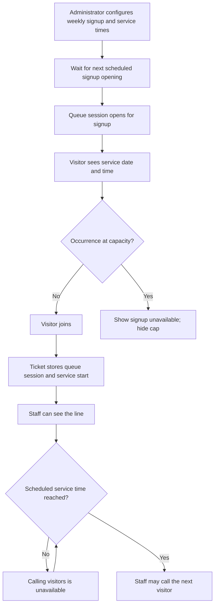

# Recurring queue signup and service start

## Goal

Let an organization schedule when visitors can claim a place in a queue and when staff may begin serving them. Show visitors the scheduled service start for the specific queue session they joined.

## Shared rules

- A schedule belongs to a queue because different services at one location may operate at different times. Interpret schedule times in the queue location's timezone.
- Keep recurring schedule configuration separate from a queue session occurrence. Each occurrence records the actual signup-open time and its scheduled service start.
- A service start time is a scheduled operating time, not an estimated wait or a promise that an individual ticket will be served at that exact time.
- A per-occurrence signup cap limits the total tickets issued for that occurrence. Completing or cancelling a ticket does not free a slot. Keep this separate from the existing active-ticket limit, which limits concurrent active tickets.
- Do not disclose the configured cap to visitors. When a queue is full, explain that signup is unavailable without showing the number.
- If the schedule changes, apply the change to future occurrences. Visitors with tickets keep the service start recorded for their occurrence.

## Flow

## AQ-9: Schedule recurring queue signup and service start

**Status** — Planned

**User story** — As an organization administrator, I want to schedule recurring signup and service times for a queue so visitors can claim tickets before service begins and staff know when to start calling them.

### Acceptance criteria

- An administrator can configure one or more weekdays, a local signup-open time, a later local service-start time, and an optional per-occurrence ticket cap.
- The schedule is associated with the queue's location timezone. Invalid weekdays, times, timezone values, or a service start earlier than signup opening are rejected with clear errors.
- At the scheduled signup opening, the system creates or opens one queue-session occurrence and makes its public signup available without requiring staff to open it manually.
- Schedule processing is idempotent: retries, reconnects, and application restarts cannot create duplicate sessions or issue duplicate ticket numbers for one occurrence.
- Staff can view the waiting line before service starts, but cannot call the next visitor until the occurrence's service-start time.
- A configured cap applies to total tickets issued in that occurrence, does not replenish when tickets become terminal, and is enforced for concurrent join attempts.
- Reaching the cap prevents further joins and presents a generic full/unavailable state to visitors without exposing the cap value.
- Editing a recurring schedule affects future occurrences. Existing sessions and their tickets retain their recorded scheduled service-start time.
- Queues without a recurring schedule retain the current manual session-opening behavior.

**Dependencies** — AQ-1, AQ-2, AQ-6, OLA-4, visitor signup and ticket tracking.

## AQ-10: Set a service start time for a manual queue session

**Status** — Planned

**User story** — As an organization administrator or authorized staff member opening a manual queue session, I want to optionally set when service is scheduled to start so visitors and staff know the planned start time even when the queue has no recurring schedule.

### Acceptance criteria

- When opening a queue session manually, authorized staff can leave the scheduled service start unset or provide a date and time.
- The entered local date and time is interpreted in the queue location's IANA timezone and stored on that specific queue-session occurrence as an unambiguous timestamp.
- Invalid or nonexistent local times are rejected with a clear message. Ambiguous daylight-saving times require an explicit, documented choice by the staff member or a consistent product rule.
- A manual session's scheduled service start is shown on its public queue page and join form before signup, and is retained for tickets issued in that session.
- A manual session with no scheduled start continues to work as it does today and shows no scheduled service-start message.
- Staff can see the session's scheduled start in the live queue view. This story does not prevent staff from calling visitors before that time; start-time gating is scoped separately.
- Recurring schedules continue to provide the start time for sessions they create. Editing a recurring schedule does not alter existing sessions.
- If a session has a scheduled start, that occurrence value is authoritative for display even if the recurring schedule or location timezone changes later.

### Scope

- Add an optional scheduled service-start timestamp to `QueueSession` and its migration.
- Add the field to the manual session-opening flow, validate it in the location timezone, and persist it atomically with session creation.
- Include the session value in public queue, join, ticket tracking, and staff live queue views.
- Keep recurring queue configuration separate. AQ-9's schedule values are templates for future occurrences; AQ-10's session timestamp is the value for one concrete occurrence.

### Out of scope

- Automatically opening sessions or scheduling background jobs; covered by AQ-9.
- Preventing staff from calling visitors before the scheduled start.
- Changing ticket order, estimates, or queue capacity behavior.
- A start time attached to the reusable service or queue without a specific session date.

**Dependencies** — AQ-1, AQ-2, AQ-9, visitor signup and ticket tracking.

## VF-11: See when queue service is scheduled to begin

**Status** — Planned

**User story** — As a visitor considering or joining a scheduled queue, I want to see when service is scheduled to begin so I can decide whether to join and when to arrive.

### Acceptance criteria

- Before joining, the public queue page and join form show the next occurrence's service-start weekday, date, time, and location timezone.
- After joining, the confirmation and private tracking page show the service-start time recorded for that ticket's occurrence, even if the recurring schedule is later edited.
- The time is formatted using the location's timezone and is clearly labeled as the scheduled service start, not a personal wait estimate.
- If signup is not open yet, show when it opens. If the occurrence is full or unavailable, explain that visitors cannot join without revealing the configured cap.
- A stale page cannot create a ticket for an occurrence that has closed or reached its cap; the visitor receives a clear unavailable message.

**Dependencies** — AQ-9; VF-1, VF-2, VF-4, VF-5, VF-6, and VF-7.

## Initial policy decisions

- Signup opens at the configured local time. It remains available after service begins until the occurrence reaches its cap or staff close it under the existing queue-session rules. A separate signup-close time is out of scope for this first slice.
- Service-start times are recurring wall-clock times in the location timezone. Daylight-saving changes follow the timezone database rules for that local date; ambiguous or nonexistent local times must be resolved explicitly by the scheduler and documented in its behavior.
- When a prior session has not been closed by the next scheduled occurrence, the system must not silently create a second open session. Surface the missed occurrence to staff for resolution.
- The business must decide how staff close an occurrence with unserved visitors before production scheduling is enabled; current queue-session close rules require active tickets to be resolved first.

## Suggested implementation slices

1. Add recurring schedule configuration and admin validation for a queue.
2. Create idempotent scheduled session occurrences, enforce per-occurrence ticket caps, and gate staff calling until service start.
3. Show next-occurrence time in public discovery and join screens.
4. Persist the occurrence's service-start time for issued tickets and show it on confirmation and private tracking pages.
5. Add focused tests for timezone boundaries, scheduler retries, concurrent signup at capacity, stale pages, and queue-session state transitions.
