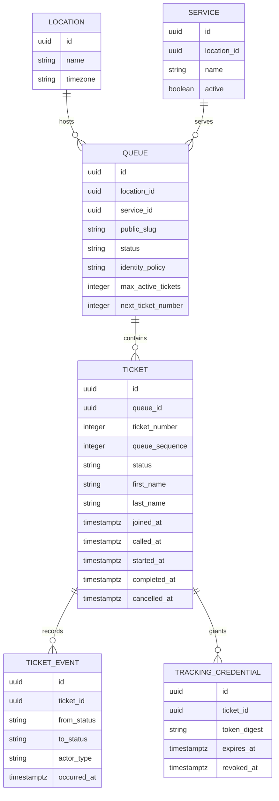
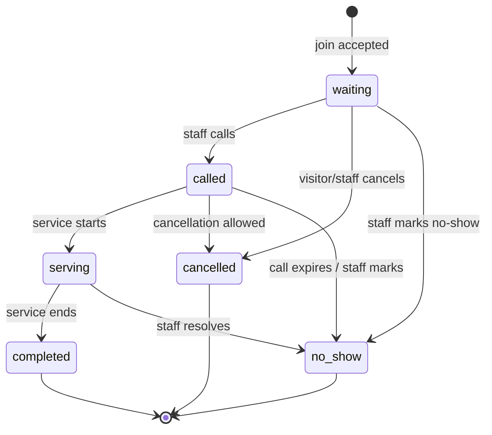

# Visitor-flow data model

## Scope and principles

This is the logical data model for the initial visitor flow in [the visitor stories](visitor-flow-user-stories.md). It covers a published queue, anonymous or name-required ticket creation, private ticket tracking, and durable state history. It does not define staff authentication, full organization setup, notification delivery, or analytics storage.

The initial design uses PostgreSQL through AshPostgres and keeps the application as a modular monolith. Visitors do not need account records. The ticket is the visitor's durable queue record; a public ticket number is for recognition, while a separate secret grants access to the private tracking page.

## Entity relationship sketch

`Location` and `Service` are included to show the queue's context. Their complete ownership, staff membership, and configuration schema belongs to the business foundation stories. If a location can offer a service at multiple locations, service ownership should be normalized differently; decide this when those stories are scoped.

## Entities

### Queue

Represents one joinable line for a service at a location.

| Field | Type | Rules and purpose |
|---|---|---|
| `id` | UUID | Internal primary key; never used as the public tracking secret. |
| `location_id` | UUID | Required owning location. |
| `service_id` | UUID | Required service being provided. |
| `public_slug` | String | Unique, non-sequential link component for the join page; may be rotated/revoked. |
| `status` | Enum | Initially `open`, `paused`, or `closed`; only `open` accepts joins. |
| `identity_policy` | Enum | `anonymous` or `name_required`; source of truth for join form and validation. |
| `max_active_tickets` | Integer, nullable | Optional capacity; null means no configured cap. |
| `next_ticket_number` | Integer | Counter for the next display number; increment atomically when joining. |
| `next_queue_sequence` | Bigint | Monotonic ordering value assigned to accepted tickets; independent of display number. |
| `created_at`, `updated_at` | Timestamps | Audit timestamps. |

The queue identity policy is read from the persisted queue during ticket creation. Do not accept the identity policy from visitor-submitted parameters. Store the policy on the queue; duplicating it on each ticket is not needed for the initial workflow unless the product later needs a historical snapshot of the collection policy.

### Ticket

Represents one visitor's admission to a queue.

| Field | Type | Rules and purpose |
|---|---|---|
| `id` | UUID | Internal identifier. |
| `queue_id` | UUID | Required parent queue. |
| `ticket_number` | Integer | Visitor-facing number, unique within a queue's number cycle. It is not an authorization secret. |
| `queue_sequence` | Bigint | Stable FIFO sequence assigned at join time. Position is derived from this value and current queue state, not stored as a mutable counter on each ticket. |
| `status` | Enum | Initially `waiting`, `called`, `serving`, `completed`, `cancelled`, or `no_show`. |
| `first_name` | String, nullable | Required when the queue policy is `name_required`; must be null for `anonymous`. |
| `last_name` | String, nullable | Required when the queue policy is `name_required`; must be null for `anonymous`. |
| `joined_at` | UTC timestamp | When the ticket was admitted. |
| `called_at` | UTC timestamp, nullable | Latest call transition, if any. |
| `started_at` | UTC timestamp, nullable | When service began, if any. |
| `completed_at` | UTC timestamp, nullable | When completed, if any. |
| `cancelled_at` | UTC timestamp, nullable | When cancelled by visitor/staff, if applicable. |
| `inserted_at`, `updated_at` | UTC timestamps | Persistence timestamps. |

Names should be trimmed and validated server-side. Avoid storing a combined full name when separate fields are required. Anonymous tickets have both name fields null. No contact details are included in the first visitor-flow model.

### Ticket event

An append-only record of a ticket transition. This supports status recovery, an audit trail, and later wait-time analysis.

| Field | Type | Rules and purpose |
|---|---|---|
| `id` | UUID | Internal primary key. |
| `ticket_id` | UUID | Required ticket. |
| `from_status` | Enum, nullable | Null for the initial `joined` event. |
| `to_status` | Enum | Status after the transition. |
| `actor_type` | Enum | Initially `visitor`, `staff`, or `system`; a staff user ID can be added with the staff model. |
| `actor_id` | UUID, nullable | Optional reference to an authenticated actor when available. |
| `occurred_at` | UTC timestamp | Event time, assigned by the server. |
| `metadata` | Map/JSONB, nullable | Small non-sensitive operational details only; never place tracking tokens or unnecessary personal data here. |

The ticket's `status` and timestamps are the fast current-state projection. The event rows are the durable history. Update both in one transaction and prohibit arbitrary visitor writes to status.

### Tracking credential

Authorizes access to exactly one ticket's private tracking page.

| Field | Type | Rules and purpose |
|---|---|---|
| `id` | UUID | Internal primary key. |
| `ticket_id` | UUID | Required ticket. |
| `token_digest` | Binary or fixed-length string | Unique digest of a high-entropy random token. Store only the digest, never the raw token. |
| `created_at` | UTC timestamp | Credential creation time. |
| `expires_at` | UTC timestamp, nullable | Optional until a token lifetime is selected. |
| `revoked_at` | UTC timestamp, nullable | Revocation time; a revoked token cannot be used. |

Generate a cryptographically random bearer token with sufficient entropy, show the raw value only in the returned link, and hash it before persistence. Use a constant-time comparison where digest verification is performed in application code. The public ticket number, queue slug, and internal UUID must not substitute for this credential. A visitor can use the same credential to view and, when policy permits, cancel their own ticket.

## State model

This is a candidate transition graph. The first join story only needs `waiting`; called/serving/completed/no-show transitions depend on staff workflows. A business decision is needed on visitor cancellation after the ticket is called or service begins. Terminal tickets do not count toward active capacity or queue position.

## Derived values

Do not persist values that can be calculated reliably from current tickets:

- **Position**: count eligible active tickets in the same queue with an earlier `queue_sequence`, applying the defined status rules.
- **Waiting count**: count tickets in position-bearing states.
- **Estimated wait**: estimate based on active tickets ahead and available completed-service duration history. Return “estimate unavailable” until there is sufficient input; if computed on demand becomes expensive, cache it only with a clear invalidation rule.
- **Queue availability**: derive joinability from queue status and active-ticket count versus optional capacity within the join transaction.

Define the position-bearing states explicitly alongside the queue transition implementation. At minimum, cancelled, completed, and no-show tickets no longer count. Whether `called` and `serving` count as ahead of another visitor depends on the service model and must be consistent in the staff and visitor views.

## Constraints and indexes

- Foreign keys from queue to location/service, ticket to queue, and event/credential to ticket.
- Unique index on `queues.public_slug`.
- Unique index on `(tickets.queue_id, tickets.ticket_number)` when numbers are unique for the queue's lifetime. If numbers reset, include the selected queue-cycle/day key in the uniqueness scope.
- Unique index on `(tickets.queue_id, tickets.queue_sequence)`.
- Check constraint or Ash validation ensuring `ticket_number > 0`, `queue_sequence > 0`, and positive `max_active_tickets` when present.
- Check constraint (and domain validation) enforcing name fields: both null for anonymous tickets, both non-empty for name-required tickets. Because PostgreSQL cannot directly enforce a cross-table queue policy with a simple check, enforce policy in the transactional create action; optionally snapshot the policy if database-level enforcement becomes a requirement.
- Index `(tickets.queue_id, status, queue_sequence)` for active queue and position lookups.
- Index `(ticket_events.ticket_id, occurred_at)` for ticket history.
- Unique index on `tracking_credentials.token_digest`; index active credentials by `ticket_id`.
- Consider partial indexes for active tickets once query shape and status rules are established.

## Join transaction

Ticket creation must be one server-side operation with the following shape:

1. Resolve the queue using its public slug and load its authoritative state/policy.
2. Lock the queue row or use an equivalent atomic mechanism to serialize number/sequence allocation and capacity checks.
3. Recheck that the queue is open and below capacity while holding the lock.
4. Validate input against the queue identity policy: discard/reject unexpected names for anonymous joins; require normalized first and last names for `name_required`.
5. Allocate the display number and queue sequence atomically.
6. Insert the ticket in `waiting` state and its initial event.
7. Generate a tracking token, store only its digest, and return the raw token once to build the private link.
8. Commit all records together; on any failure, create no ticket and do not consume a ticket number unless the selected numbering policy explicitly allows gaps.

Repeated submit handling needs an idempotency strategy. A short-lived join-attempt key can be unique per queue and request attempt, but must not be used as the tracking credential. Decide whether retries should return the already-created ticket link or ask the visitor to restart if the original response was lost.

## Ash resource boundary proposal

Implement resources incrementally in the domain module that owns queues/tickets. Candidate resources are `Queue`, `Ticket`, `TicketEvent`, and `TrackingCredential`. Expose narrow actions such as `get_public_queue`, `join`, `get_by_tracking_token`, and `cancel_by_tracking_token`; avoid public generic CRUD actions. The join action should own the transaction and event publication should happen only after commit. Authorization for staff actions belongs in policy/action boundaries; public actions accept only the public slug, allowed visitor fields, and scoped tracking credential.

Exact Ash domain/resource file names and action declarations should be designed in the implementation story, after confirming the installed Ash APIs and generating the initial migration.

## Open decisions

- Are ticket numbers sequential for a queue's lifetime, reset daily, or reset when the queue is reopened? This determines display-number uniqueness and queue-cycle modeling.
- How long does a tracking link remain valid, and when can it be revoked?
- Should a visitor retry receive the existing ticket or create a new one after an ambiguous network failure?
- Which statuses count as ahead in position and active capacity?
- Can visitors cancel after being called or after service begins?
- How many completed durations are required before showing a wait estimate, and what is the fallback?
- What retention period applies to names and ticket/event records?
- Can a service be offered at multiple locations, or does each location own its own service definitions?

Resolve these as part of the related story before encoding policy in migrations or irreversible actions.
