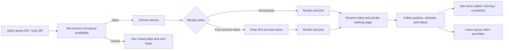

# Visitor flow user stories

## Goal

Let a visitor join and follow a queue from a phone browser without installing an app or creating an account. The visitor flow must respect each queue's identity policy: anonymous ticket or first and last name required.

For recurring signup windows and scheduled service starts, see [queue-scheduling-user-stories.md](queue-scheduling-user-stories.md).

The proposed logical schema, constraints, and join transaction are documented in [visitor-flow-data-model.md](visitor-flow-data-model.md).
Future visitor-flow ideas that are not part of the current implementation are tracked in [todo-features.md](todo-features.md).

These stories define the first product implementation area. They assume a business has already configured a location, service, queue, and join policy. Staff setup and queue management are dependencies, but are not part of this visitor-flow implementation scope.

**Status tracking** — `Complete` means the story's acceptance criteria are implemented; `In progress` means some criteria remain; `Planned` means implementation has not started. Status tracks implementation in this repository, not production release.

## Visitor journey

## Shared product rules

- The visitor experience is mobile-first and works in a modern browser without an account or app installation.
- A queue's configured identity policy is authoritative. The page only asks for the information required by that policy, and the server enforces the same policy.
- Each successful join creates one ticket with a visitor-facing number and a separate unguessable tracking credential. The public tracking URL must not expose a database ID or allow access to another visitor's ticket.
- Ticket numbers start at 1 for each new queue session. Pausing and resuming the same session does not reset numbering; closing it and starting a new session does.
- The ticket's current state and queue order come from persisted server data. Queue position is included in the initial release. Estimated wait is a nice-to-have and is out of scope for the initial release.
- Collect only the information required for the selected queue. Do not add phone number, email, or notification consent to the initial join form unless a separate story establishes the need.
- If a queue becomes unavailable during the join flow, preserve entered data where safe and explain that the visitor could not join; do not show a success ticket unless creation succeeded.

## Stories

### VF-1: Open a queue from a shared link or QR code

**Status** — Complete

**User story** — As a visitor, I want to open a queue from a link or scanned QR code so that I can see where to join without installing an app.

**Acceptance criteria**

- Given a valid public queue link, when I open it on a phone or desktop browser, then I see the business/location name, service name, and current join availability.
- Given an invalid or revoked link, when I open it, then I see a clear unavailable page and no queue or visitor data is exposed.
- The page identifies the service and location in text, not only through a logo or color.
- The page remains usable at narrow mobile widths and with keyboard navigation.

**Dependencies** — A public queue URL/QR target and a configured location/service.

### VF-2: Understand whether a queue is open

**Status** — Complete

**User story** — As a visitor, I want to know whether I can join before entering details so that I do not waste time on a queue that is unavailable.

**Acceptance criteria**

- Given an open queue, then the page provides a clear action to continue joining.
- Given a closed, paused, or full queue, then the page explains that joining is unavailable and does not present an enabled join action.
- If the queue changes state after the page loads, the server rejects a now-invalid join and the visitor receives a useful explanation.
- Closed-state copy may include configured reopening information when available; it must not invent an opening time.

**Dependencies** — Queue availability and capacity state. Reopening schedule is optional and outside the first slice.

### VF-3: Select a service when a location offers more than one

**Status** — Complete

**User story** — As a visitor, I want to choose the service I need so that I join the correct queue.

**Acceptance criteria**

- Given multiple joinable services, then each option shows a plain-language service name and useful queue information, such as queue position where available. Estimated wait is a nice-to-have and is out of scope for the initial release.
- I can select exactly one service before joining.
- Given a link for a single specific queue, then service selection can be skipped and that queue is shown directly.
- A service that is closed or unavailable cannot be selected for joining.

**Dependencies** — Location's public service list and queue availability. A direct queue link is the initial minimum path.

### VF-4: Join an anonymous queue

**Status** — Complete

**User story** — As a visitor using an anonymous queue, I want to receive a number without sharing my name so that I can wait while keeping the interaction minimal.

**Acceptance criteria**

- Given a queue configured for anonymous joining, then the join form does not request first name, last name, email, or phone number.
- When I confirm joining, then the server creates one ticket with the next valid visitor-facing number and returns its private tracking page.
- If required queue data is invalid or the queue is no longer joinable, then no ticket is created and I see an actionable error.
- Repeated submission caused by a slow connection or double tap does not silently create duplicate tickets for the same join attempt.
- The visitor-facing ticket number is not used as the authorization credential for the private tracking page.

**Dependencies** — Ticket creation, deterministic queue ordering/numbering, and private tracking credential.

### VF-5: Join a queue that requires first and last name

**Status** — Complete

**User story** — As a visitor at a service that matches tickets to people, I want to provide my first and last name so staff can identify me when my number is called.

**Acceptance criteria**

- Given a queue configured to require a name, then the join form displays clearly labeled first-name and last-name fields.
- Submitting either required field empty keeps me on the form, identifies the missing field, and does not create a ticket.
- The server validates both fields even if a client bypasses the form.
- On successful submission, the ticket stores the provided name and the confirmation identifies the visitor without unnecessarily repeating private details.
- The policy is read from the selected queue on the server; a client cannot choose to omit required names by changing request parameters.

**Dependencies** — Queue identity policy and ticket name fields.

### VF-6: Receive a ticket and private tracking page

**Status** — Complete

**User story** — As a visitor who joined successfully, I want a clear ticket confirmation and a private page so I can verify my place and return to it later.

**Acceptance criteria**

- After successful creation, I see my ticket number, service/location, current status, and queue position.
- The page clearly distinguishes the ticket number from the private tracking link/token.
- Refreshing or reopening the private link shows the same ticket from persisted data.
- A malformed, expired, or revoked token shows an unavailable state without revealing whether other tickets exist.
- The page offers a usable way to copy or share the tracking link without exposing it in a public queue listing.

**Dependencies** — VF-4 or VF-5; durable tickets; secure tracking URL. Link expiration/retention policy must be decided before implementation.

### VF-7: Follow queue position and status changes

**Status** — Complete

**User story** — As a waiting visitor, I want my ticket page to stay current so I know when my turn is approaching.

**Acceptance criteria**

- The page shows the latest persisted ticket status and position among eligible tickets ahead of me.
- Estimated wait is a nice-to-have and is out of scope for the initial release. If added later, it must be labeled as an estimate and say when data is insufficient rather than display a misleading number.
- When staff call, begin serving, or complete my ticket, the visitor view updates promptly while connected.
- If I lose connection or refresh, the page recovers by loading current persisted state.
- Updates for another visitor never expose their name, contact details, or private tracking credential.

**Dependencies** — Staff queue transitions in [staff-admin-flow-user-stories.md](staff-admin-flow-user-stories.md) and a refresh/live-update mechanism. The first implementation may use page refresh or polling; live updates across connected screens are specified in SF-8.

### VF-8: Leave or cancel my place in line

**Status** — Complete

**User story** — As a visitor who can no longer wait, I want to leave the queue so staff do not hold my place unnecessarily.

**Acceptance criteria**

- The private ticket page offers a clearly labeled leave action only while the ticket is in a state where visitor cancellation is allowed.
- The action asks for confirmation before changing the ticket.
- Confirming changes the ticket to a terminal cancelled state and removes it from active queue position calculations.
- Repeating the action is safe and does not create inconsistent state.
- A ticket already called or being served follows the configured policy and explains when self-cancellation is unavailable.

**Dependencies** — Ticket state transitions. Initial policy permits visitor cancellation only while waiting; a later policy change can allow cancellation after call or while serving.

### VF-9: Understand when I am called

**Status** — Complete

**Status note** — The private ticket page renders a prominent called state with service-configured visitor instructions (or a clear default), renders serving and no-show states separately, and reloads from persisted state when polling detects a transition.

**User story** — As a visitor whose turn has arrived, I want an unmistakable call-to-action on my tracking page so I know what to do next.

**Acceptance criteria**

- When the ticket becomes called, the page presents a prominent called state and clear next step (for example, where to go or who to approach) using configured instructions if present.
- The call state is available after refresh and is not based only on a transient browser event.
- If a call expires or is skipped, the page shows the resulting state and next steps without implying the visitor is still being served.
- The page does not depend on sound, color, or push notification permission to communicate the called state.

**Dependencies** — Staff call/skip operations and configurable service instructions. SMS/push notification delivery is not required for this story.

### VF-10: See a service completion confirmation

**Status** — Complete

**Status note** — The existing private tracking URL renders a thank-you receipt for completed tickets, hides active-queue and link-copy controls, and stops polling after terminal states. Cancelled and no-show tickets retain distinct status and next-step messages.

**User story** — As a visitor whose service is complete, I want a thank-you confirmation so I know I can leave and no longer need to monitor my place in line.

**Acceptance criteria**

- When the ticket becomes `completed`, the private tracking page changes to a clear thank-you state and identifies the completed ticket and service.
- The completed view removes active-queue controls and information, including queue position, the leave action, and the copy-private-link control.
- The existing private URL continues to show the completion confirmation when refreshed or reopened; it does not redirect to an unrelated page or become an unavailable link immediately after service.
- The visitor's view updates promptly when completion occurs while the page is open. After completion, it does not continue polling for queue position.
- The confirmation does not expose additional personal information or imply that the ticket is still active.
- Cancelled and no-show tickets keep their own status and next-step messaging; they are not presented as successful service completion.

**Dependencies** — VF-6 and VF-7; persisted completed ticket state and status refresh.

**Design decision** — Render the thank-you state at the existing private tracking URL rather than redirecting to a generic page. This preserves a useful refresh destination and avoids a redirect that discards the ticket context. The page hides the share/copy controls after completion while the original private URL remains usable as a completion receipt.

## Suggested implementation order

1. **Direct queue link and availability** — VF-1, VF-2 for one queue per link.
2. **Join and confirmation** — VF-4 and VF-5 with server-side policy enforcement, durable ticket creation, and private tracking link (VF-6's core).
3. **Return and track** — remaining VF-6 plus VF-7 using persisted state; add live updates once queue operations exist.
4. **Visitor self-service** — VF-8 after cancellation policy is decided.
5. **Called state and completion** — VF-9 and VF-10 after staff queue operations are implemented.
6. **Multiple-service discovery** — VF-3 when a location's service list is available; it need not block the direct-link MVP.

Each implementation slice should have focused domain and LiveView tests for its acceptance criteria. Keep public visitor stories separate from staff queue operations so each change remains reviewable.

## Decisions to resolve before the relevant story

- Tracking-link token lifetime, revocation, and behavior after a ticket is completed.
- Whether to allow visitor cancellation after a ticket has been called or service has started.
- Whether the first release supports only direct queue links or also a location landing page with service selection.
- Whether to add estimated wait after the initial release, and its fallback when there is too little completed-service history.
- Exact service instructions shown in the called state.
- Data retention period for names and completed/cancelled tickets.
